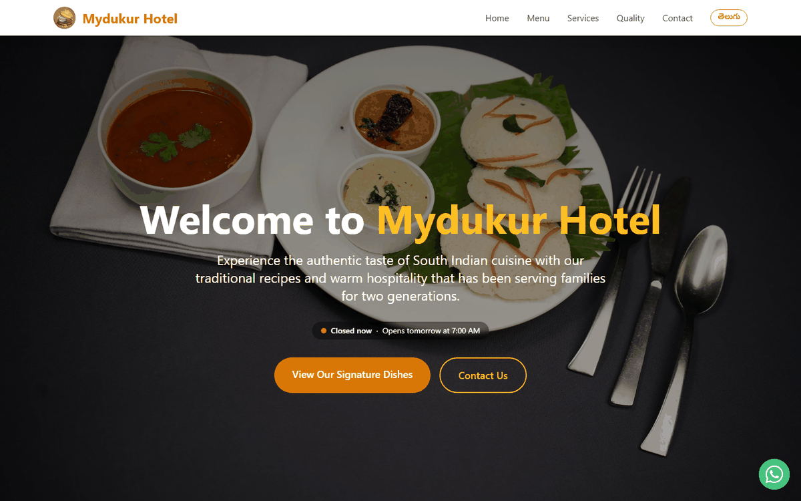

# Mydukur Hotel

Website for Mydukur Hotel, a South Indian restaurant on Main Bazaar, Atmakur, Nellore (Andhra Pradesh), known for dosas such as Masala, Karam and Ghee Karam Podi.

Live site: https://mydukurhotel.netlify.app/



## About

A static restaurant website built for a real local business, published with the owner's permission. It tells customers who the restaurant is, what it serves and where to find it.

## Tech stack

* React 19 and TypeScript
* Vite for the dev server and production build
* Tailwind CSS for styling
* pnpm for package management
* Netlify for hosting (static deploy, configured in `netlify.toml`)

## Highlights

* One-page home with separate Privacy and Terms pages and a custom 404 page
* Search and social friendly: meta description, keywords, Open Graph tags, a Twitter card tag, restaurant structured data for Google and a sitemap
* Static build with no backend to maintain
* English and Telugu versions with a one-tap language switch
* Live "Open now" status based on the shop's hours in India time
* WhatsApp button and a contact form that opens a ready-to-send WhatsApp message, plus tap-to-call and Google Maps directions
* Photos served as WebP, with the hero image preloaded and dish photos lazy-loaded

## Run it locally

```bash
pnpm install
pnpm dev        # http://localhost:8080
pnpm build      # outputs the static site to dist/
pnpm preview    # serve the production build locally
pnpm typecheck
```

## Project structure

```
client/
├── App.tsx         # entry point and routes
├── pages/          # Index (home), Privacy, Terms and NotFound
├── components/     # contact form, language switch, shop status, WhatsApp button
├── i18n/           # English and Telugu text
├── lib/            # opening hours, contact details, form validation
├── assets/         # dish photos
└── global.css      # Tailwind theme tokens
public/             # logo, hero photos, sitemap, robots.txt
```

## Deployment

Deployed to Netlify as a static site. See `netlify.toml` for the build settings.

## Author

Built by Somisetty Sai Rithin, freelance full stack developer.

* Email: sairithinkumar@gmail.com
* GitHub: https://github.com/rithin2004
* LinkedIn: https://www.linkedin.com/in/somisettysairithin

## License and content ownership

Source code: Copyright (c) 2025-2026 Somisetty Sai Rithin. All rights reserved. The code is public for portfolio and evaluation purposes only. Please do not copy, redistribute or reuse it without written permission.

The restaurant name, logo, photos and text content belong to Mydukur Hotel.
