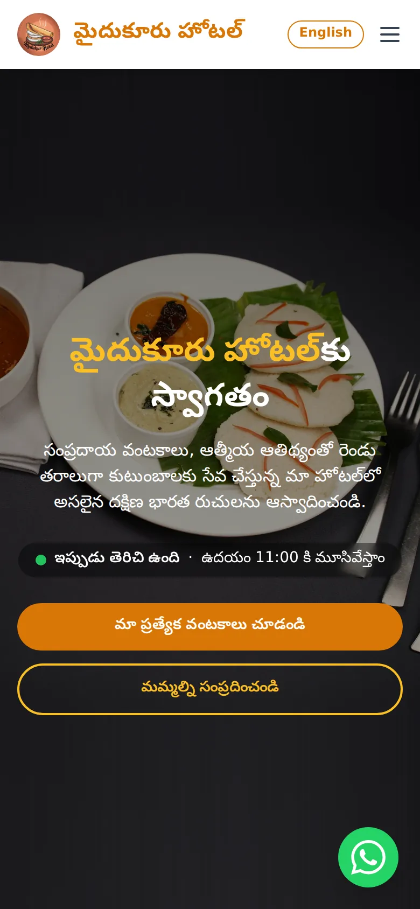
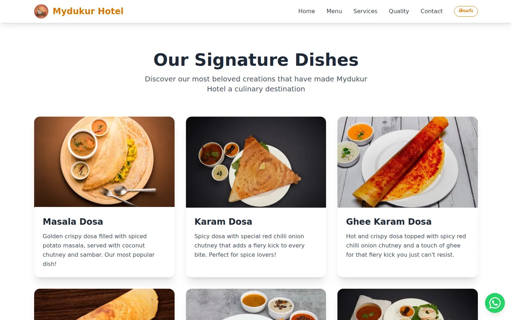

<div align="center">


# Mydukur Hotel

### Authentic South Indian dosas, served with love for two generations

**Main Bazaar, Atmakur, Nellore · Open daily 7:00 AM – 11:00 AM**

[**🌐 Visit the website**](https://mydukurhotel.netlify.app/) &nbsp;·&nbsp;
[**🗣️ Read in Telugu**](https://mydukurhotel.netlify.app/?lang=te) &nbsp;·&nbsp;
[**💬 WhatsApp us**](https://wa.me/919885973718)

<br />


</div>

<br />

<p align="center">
  
</p>

<p align="center">
  
  &nbsp;&nbsp;
  
</p>

---

## ✨ Highlights

| Feature | What it does |
|---|---|
| 🍽️ **Signature dishes & full menu** | Masala Dosa, Karam Dosa, Ghee Karam Podi Dosa, Idly Sambar and more, with photos |
| 🌐 **English & Telugu** | Every page, button and WhatsApp message in both languages, one tap to switch |
| 🟢 **Live “Open now” status** | Shows whether the hotel is open right now (India time), and when it opens next |
| 💬 **WhatsApp everywhere** | Floating chat button, plus a contact form that turns into a ready-to-send WhatsApp message |
| 📞 **Tap to call & directions** | Phone number opens the dialer; Get Directions opens Google Maps navigation |
| ⚡ **Fast on mobile data** | Compressed WebP photos, preloaded banner, lazy-loaded dish photos, long-term caching |
| 🔍 **Found on Google** | Restaurant details for Google Search and Maps, sitemap, and rich link previews on WhatsApp/Facebook |
| 🔒 **Safe by design** | No accounts, no tracking, nothing stored on a server; strict browser security headers |
| ⚖️ **Privacy Policy & Terms** | Plain-language legal pages in English and Telugu |

<p align="center">
  
</p>

---

## 🛠️ Updating the website

Most everyday changes are a single line in one file.

| I want to… | Edit this |
|---|---|
| Change any text (English or Telugu) | `client/i18n/translations.ts` |
| Mark a holiday (shows **“Closed today”**) | Add the date to `CLOSED_DATES` in `client/lib/hours.ts`, e.g. `"2026-10-20"` |
| Change opening hours | `OPEN_MINUTES` / `CLOSE_MINUTES` in `client/lib/hours.ts`, plus the hours text in `translations.ts` |
| Change the phone / WhatsApp number | `client/lib/contact.ts` |
| Replace a dish photo | `client/assets/` (WebP, about 960 px wide) |

Every change merged into `main` goes live on Netlify automatically within a minute or two.

---

## 🚀 Run it locally

Requires [Node.js](https://nodejs.org/) 22+ and [pnpm](https://pnpm.io/).

```bash
pnpm install      # install dependencies
pnpm dev          # start at http://localhost:8080
```

| Command | What it does |
|---|---|
| `pnpm dev` | Development server with instant reload |
| `pnpm build` | Production build into `dist/` |
| `pnpm preview` | Preview the production build |
| `pnpm typecheck` | TypeScript checks |
| `pnpm format` | Format the code with Prettier |

Tip: add `?lang=te` to any page address to open it in Telugu.

---

## 📁 Project structure

```
client/
├── App.tsx            # entry point and page routes
├── pages/             # Home, Privacy Policy, Terms of Use, 404 (+ Telugu legal text)
├── components/        # contact form, language switch, shop status, WhatsApp button, …
├── i18n/              # all English and Telugu text
├── lib/               # opening hours, contact details, form validation
├── assets/            # dish photos
└── global.css         # Tailwind setup and theme colours
public/                # logo, banner photos, sitemap, robots.txt
docs/screenshots/      # images used in this README
netlify.toml           # build settings, caching and security headers
```

---

## 🔒 Privacy & security

- The contact form never sends data to a server. It only prepares a WhatsApp message on the visitor's own phone.
- Name and mobile number are validated as they are typed (letters only; exactly 10 digits, with `+91` removed automatically when pasted).
- No cookies, analytics or ad trackers of our own.
- Content-Security-Policy, HSTS, `X-Frame-Options`, `nosniff`, Referrer-Policy and Permissions-Policy headers on every page.

---

<div align="center">

**Mydukur Hotel** · Main Bazaar, Atmakur, Nellore, Andhra Pradesh

📞 [+91 98859 73718](tel:+919885973718) &nbsp;·&nbsp; 🌐 [mydukurhotel.netlify.app](https://mydukurhotel.netlify.app/)

© Mydukur Hotel. All rights reserved. Photos, logo and content may not be reused without permission.

</div>
